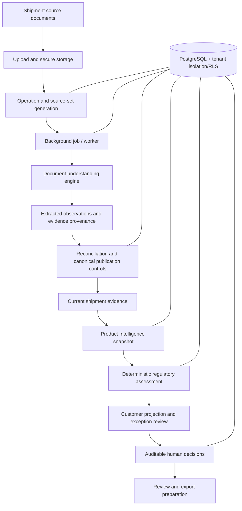

# Litoral Trace — U.S. Lacey Act Evidence & Review Platform

[](https://lacey.litoraltrace.com)
[](https://www.python.org/)
[](https://fastapi.tiangolo.com/)
[](https://www.postgresql.org/)

**Litoral Trace is a production-oriented B2B RegTech application for preparing and reviewing documentary evidence associated with U.S. Lacey Act workflows.** It helps importers and customs-broker teams organize shipment documents, reconcile product and shipment facts, identify missing or conflicting evidence, and preserve an auditable human-review trail.

- **Live application:** https://lacey.litoraltrace.com
- **Repository:** https://github.com/Jose34345/litoral_trace
- **Product scope:** U.S. Lacey Act evidence preparation and review. The application supports preparation workflows; it does not claim autonomous federal filing or guaranteed regulatory compliance.

> This repository is presented as an engineering case study. Production access, customer data, credentials, and administrative capabilities are not part of the portfolio.

## Why this is an interesting engineering project

This is not a tutorial CRUD application. It is a multi-stage document-processing system with domain-specific constraints:

- Multiple source documents can describe the same shipment or product with incomplete, inconsistent, or differently formatted facts.
- Extracted values must retain their source and provenance; a plausible AI output is not automatically an authoritative fact.
- Missing information, ambiguity, and conflicts must remain visible instead of being silently converted into a successful result.
- Processing is asynchronous and must preserve operation, tenant, and source-set boundaries.
- Human decisions are explicit, attributable, and auditable.

The core engineering problem is therefore not just extracting text. It is controlling how evidence becomes a reviewable operational result.

## Architecture

The application is structured as a **modular monolith**: one deployable application with explicit domain boundaries, background processing, and shared PostgreSQL persistence. This keeps operational complexity proportionate while allowing the document engine, regulatory logic, and customer workflow to evolve independently.



### Main code boundaries

| Area | Responsibility |
|---|---|
| `src/litoral_trace/lacey_engine/` | Document understanding, classification, extraction candidates, source authority, specialist orchestration, line binding, and candidate fusion |
| `src/litoral_trace/us_lacey/` | U.S. Lacey operations, jobs/workers, source-set lifecycle, reconciliation, canonical publication, review, and export preparation |
| `src/litoral_trace/product_intelligence/` | Structured product-composition/BOM observations, normalization, row-level issues, and source anchors |
| `src/litoral_trace/us_lacey/regulatory/` | Versioned taxonomy resolution and deterministic, rule-scoped regulatory evaluations |
| `src/litoral_trace/db/models/` + `alembic/` | Relational persistence and versioned schema migrations |
| `src/litoral_trace/web/` + `src/litoral_trace/templates/us_lacey/` | Server-rendered product interface and application routes |
| `tests/` + `.github/workflows/` | Executable behavior contracts and automated verification |

For the implementation-level description, see [the canonical architecture guide](docs/us-lacey/ARCHITECTURE.md), [engineering invariants](docs/us-lacey/INVARIANTS.md), and [test matrix](docs/us-lacey/TEST_MATRIX.md).

## Selected engineering capabilities

### 1. Evidence-preserving document processing
The document pipeline produces observations and candidates while retaining source context. Extraction, AI suggestions, and specialist outputs are not treated as final regulatory truth by default.

### 2. Cross-document reconciliation
The application reconciles information across shipment documents and keeps unresolved discrepancies available for review. Identity and quantitative binding are constrained by explicit evidence; weak similarity or row proximity must not manufacture a match.

### 3. Product Intelligence
Explicit BOM inputs can be parsed into SKU/component/material observations with normalized quantities and source anchors. Results are stored as source-set-scoped snapshots and remain non-canonical evidence rather than silently becoming filing declarations.

### 4. Deterministic regulatory assessment
Taxonomy resolution and regulatory rules produce explicit outcomes, including review-required or indeterminate states when inputs are missing or ambiguous. Rule-level results are versioned and traceable to their inputs; they are not represented as an overall shipment compliance verdict.

### 5. Human-in-the-loop exception handling
Review actions such as accepting, correcting, or marking supported fields as not required are explicit workflow decisions. Review operations preserve reviewer metadata and audit events. The system is designed to surface the exceptions that require a person rather than hide uncertainty behind an automated success state.

### 6. Tenant and source-set isolation
Tenant-owned data is organization-scoped and protected through PostgreSQL row-level security patterns. Processing generations are fenced so stale work cannot overwrite the current source-set result. Historical Alembic migrations are treated as immutable.

## Technical stack

- **Language/runtime:** Python
- **API and application:** FastAPI, server-rendered Jinja2 interface
- **Persistence:** PostgreSQL, SQLAlchemy, Alembic
- **Background processing:** Redis-backed job/worker infrastructure
- **Document/data processing:** PDF tooling, OCR integrations, pandas, openpyxl, and structured parsers
- **Observability:** Prometheus client metrics and health/readiness endpoints
- **Verification:** pytest-based tests and GitHub Actions workflows

The exact deployment configuration and environment variables are intentionally not reproduced here. Never commit production secrets, customer documents, database URLs, or private operational configuration.

## Engineering challenges demonstrated

- Designing a multi-stage asynchronous workflow without prematurely splitting a modular monolith into microservices.
- Preserving provenance from source document to extracted candidate, reconciliation result, review action, and export preparation.
- Preventing stale background jobs and source-set generations from replacing newer results.
- Enforcing organization boundaries in application queries and PostgreSQL RLS.
- Separating AI suggestions from deterministic rules and canonical business decisions.
- Keeping regulatory uncertainty explicit through `REVIEW_REQUIRED` / `INDETERMINATE` outcomes.
- Evolving a relational schema through additive, versioned migrations while retaining historical migration integrity.

## Local development

This repository uses environment-specific configuration for database, storage, authentication, and background workers. Configure the required environment variables for your development environment before starting the application.

A basic application entry point is available at the repository root:

```bash
python -m pip install -r requirements.txt
uvicorn main:app --reload
```

The full workflow requires its configured infrastructure dependencies; a successful web-server startup alone does not validate database, storage, or worker readiness. Use the focused test guidance in [docs/us-lacey/TEST_MATRIX.md](docs/us-lacey/TEST_MATRIX.md) when changing a capability.

## Scope and responsible claims

- The platform supports evidence preparation, reconciliation, review, and export preparation.
- AI-generated suggestions remain advisory unless the applicable evidence and authority rules support publication.
- A deterministic rule result is not an overall legal-compliance guarantee.
- The project does not claim autonomous ACE/LAWGS filing or successful federal submission.
- Production customer data and administrative access are excluded from this public portfolio.

## About this project

Designed and built by **Jose Lezcano**.

The project demonstrates backend engineering, data transformation, workflow orchestration, relational data modeling, auditability, and the translation of a complex operational/regulatory process into a usable B2B software product.
