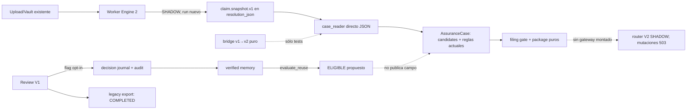
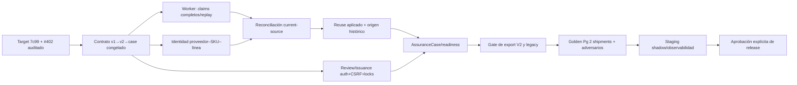

# Assurance V2 — auditoría forense de finalización

**Corte:** 2026-10-11. **Repositorio:** `Jose34345/litoral_trace`. **Alcance:** inspección estática del código, Git, contratos, pruebas y GitHub Actions; compilación Python local. No se hizo merge, commit, push, migración ni despliegue. Los enlaces de código fijan el SHA auditado `09c88049c2d8727de5e8411d3b79cc21df9facff` (PR #402), salvo donde se indica la rama integrada `7c99b04edcb8c762a75170c8cd5eb86a3a72dd56`.

## A. EXECUTIVE VERDICT

**Veredicto: NO-GO para Assurance V2 como flujo completo.** Hay una base técnica útil y ya fusionada en `feature/us-lacey-pilot-platform`, pero el único runtime V2 montado rechaza mutaciones y emisión, y el segundo embarque recibe propuestas históricas sin publicar un valor `VERIFIED_REUSE`. La evidencia disponible prueba partes, no el circuito Upload → Vault → worker → review → memoria → reuse aplicado → expediente → export.

| Pregunta | Respuesta basada en evidencia |
|---|---|
| ¿Está cerca? | Cerca de una **release candidate de shadow**; no cerca de habilitar emisión regulatoria V2. Los P0 son conexiones y gates concretos, no una reescritura. |
| ¿Cuánto? | **≈74% implementado; ≈32% integrado y validado**, estimación de auditoría, no medición de calidad productiva. Rúbrica y pesos debajo. Producción verificada: **NO VERIFICABLE**. |
| ¿Tres agentes compatibles? | Conceptualmente sí: contrato `assurance.claim.v1` / `assurance.v2/1.0.0`, V2 decision journal, memoria y `AssuranceCase` existen. **La compatibilidad runtime es parcial**: el bridge puro sólo aparece en tests, las salidas usan proyección propia y el router real no conecta decisiones ni issuance. |
| ¿Qué bloquea? | Reuse sólo propuesto; review/export V2 no activados; export legacy sin gate V2; golden completo PostgreSQL/UI/worker ausente; bridge de contrato fuera del runtime. Véanse P0-01…P0-05. |
| Camino más corto | Partir del target ya integrado y aprovechar #402; cerrar un contrato de claim/case; aplicar reuse con autoridad separada; conectar transacciones de review/issuance y gatear exports; probar dos envíos más adversarios desde upload real en PostgreSQL; shadow y después gate de release. |
| ¿Qué conservar? | Parser/claims anclados, identidad documental proveedor–SKU, migración 078 y RLS, decision/memory journal, `evaluate_reuse`, gate/exporter V2, actuales workers, Vault, audit y revisión V1. No volver a construir estos subsistemas. |

**Método de estimación.** Peso por capacidad obligatoria y fracciones `0/0,25/0,5/0,75/1`: 1 significa código completo para esa capacidad; en la columna validada significa integración en ruta real y prueba representativa, no únicamente unit tests. No se ponderó por LOC ni número de tests.

| Capacidad | Peso | Implementación | Integración verificada | Motivo principal |
|---|---:|---:|---:|---|
| Bytes/documentos → claims | 14 | 1 | 0,5 | Worker shadow + hashes y corpus PDF; sin subida HTTP E2E V2. |
| Claim/entidad/conflicto | 12 | 0,75 | 0,25 | Identidad documental limitada a caso de producto único; bridge sin consumidor runtime. |
| Decisión humana y auditoría | 14 | 0,75 | 0,5 | Adapter opt-in probado; router V2 bloqueado. |
| Promoción/memoria | 12 | 1 | 0,5 | Servicio + tests; golden construye estado manualmente. |
| Reuse **aplicado** | 16 | 0,5 | 0 | `ELIGIBLE` read-only; Pack 2 conserva campos `CANDIDATE`. |
| Readiness, expediente y outputs | 12 | 0,75 | 0,25 | Gate y paquete puros probados; emisión runtime V2 desconectada. |
| DB, RLS y seguridad de rutas | 12 | 0,75 | 0,5 | CI PostgreSQL 078/RLS verde; faltan E2E y gate legacy. |
| Golden/release representativo | 8 | 0,25 | 0 | PDFs sintéticos reales como bytes; no flujo worker/UI/export PostgreSQL V2. |
| **Suma ponderada** | **100** | **73,5 ≈74%** | **32%** | Estimación revisable al ejecutar acceptance. |

La auditoría tomó `AGENTS.md`, los `AGENTS.md` de `src/litoral_trace/us_lacey/` y `lacey_engine/`, y `docs/us-lacey/{README,ARCHITECTURE,CAPABILITIES,INVARIANTS,PIPELINE,TEST_MATRIX,ROADMAP,ASSURANCE_V2_CONTRACT,ASSURANCE_V2_IMPLEMENTATION,ASSURANCE_V2_INTEGRATION_STATUS}.md` como contexto. `ASSURANCE_V2_INTEGRATION_STATUS.md` describe un estado anterior a #402; no se utilizó como sustituto de código. `main` GitHub (`4e27866f…`) no es el target piloto; esta auditoría no infiere despliegue productivo de ningún merge al target.

## B. REPOSITORY STATE

Target vigente al corte: [`feature/us-lacey-pilot-platform@7c99b04e`](https://github.com/Jose34345/litoral_trace/commit/7c99b04edcb8c762a75170c8cd5eb86a3a72dd56); `main@4e27866f`. La rama #402 estaba limpia en el clon aislado al comenzar. Hay checkouts antiguos con cambios ajenos en Desktop; no se tocaron. La rama integrada contiene un **squash/integración funcional**, por eso los HEAD originales #396–#399 no son ancestros literales del target. No se deben volver a fusionar ciegamente.

| Rama / PR | HEAD | Estado e integración | Cambios principales | Solapes / riesgo |
|---|---|---|---|---|
| `feat/assurance-v2-contract` [#396](https://github.com/Jose34345/litoral_trace/pull/396) | `37afd225` | Abierto draft; contrato contenido en integración | `ASSURANCE_V2_CONTRACT.md` | No usar su estado abierto como señal de ausencia del contrato; [CI verde](https://github.com/Jose34345/litoral_trace/actions/runs/38016213989). |
| `feat/assurance-v2-provenance` [#397](https://github.com/Jose34345/litoral_trace/pull/397) | `00642f70` | Abierto; trabajo incorporado funcionalmente en #400 | `source_linked_claims.py`, identidad PDF, benchmark adversarial | Solapa `identity_memory.py`, `projection.py`, `review.py`, web/templates con #398; [CI verde](https://github.com/Jose34345/litoral_trace/actions/runs/38017007968). |
| `feat/assurance-v2-memory` [#399](https://github.com/Jose34345/litoral_trace/pull/399) | `155a6cba` | Abierto draft; trabajo incorporado funcionalmente en #400 | migración 078, modelos, autoridad y memoria | Depende de contrato #396; migration/CI solapa #398. [CI](https://github.com/Jose34345/litoral_trace/actions/runs/38089500274) y [PostgreSQL](https://github.com/Jose34345/litoral_trace/actions/runs/38089500275) verdes. |
| `feat/assurance-v2-outputs` [#398](https://github.com/Jose34345/litoral_trace/pull/398) | `e1317c6f` | Abierto draft; trabajo incorporado funcionalmente en #400 | `AssuranceCase`, gate, package, UI | Solapa review, identity, projection, web y CSS con #397; interfaces de autoridad separadas. [CI](https://github.com/Jose34345/litoral_trace/actions/runs/38089389136), [PostgreSQL](https://github.com/Jose34345/litoral_trace/actions/runs/38089389087), [CSS](https://github.com/Jose34345/litoral_trace/actions/runs/38089389093) verdes. |
| `feat/assurance-v2-integration-20261010` [#400](https://github.com/Jose34345/litoral_trace/pull/400) | `db95bab3` | **Merged** al target 2026-10-11 00:17 UTC | integración 65 archivos / migration 078 / shadow | Base efectiva actual es el commit integrado `7c99b04e`, no #400. |
| raw PDF QA [#401](https://github.com/Jose34345/litoral_trace/pull/401) | `4b7afa01` | **Merged** a #400 | 13 PDFs sintéticos originales con SHA manifest | Fuerte para parser; insuficiente para cliente/worker E2E. |
| `feat/assurance-v2-runtime-integration-20261011` [#402](https://github.com/Jose34345/litoral_trace/pull/402) | `09c88049` | **Abierto draft**, +12 commits desde target | claim guard, review journal opt-in, case reader/reglas actuales, autorización, issuance, 13-PDF DB test | CI/Pg/CSS verdes; no autorizado a habilitar `ENABLED`. [CI](https://github.com/Jose34345/litoral_trace/actions/runs/38115075692), [Pg](https://github.com/Jose34345/litoral_trace/actions/runs/38115075688), [CSS](https://github.com/Jose34345/litoral_trace/actions/runs/38115075686). |

`git merge-base` entre #397/#399 y #399/#398 = `c3476878…`; entre #397/#398 = `37d92856…`. Los commits exclusivos contienen principalmente `00642f70` (provenance), `c7f22b74` más fixes/CI (memory) y `9906f7a6` más shell/CSS fixes (outputs). La integración #400 ya resolvió el trabajo simultáneo; no se encontró una segunda cabeza Alembic: `078_us_lacey_assurance_v2_authority` desciende de `077` ([migration](https://github.com/Jose34345/litoral_trace/blob/09c88049c2d8727de5e8411d3b79cc21df9facff/alembic/versions/078_us_lacey_assurance_v2_authority.py#L12-L15)). El workflow exige esa cabeza; esto **no demuestra** upgrade en staging/productivo.

## C. COMPLETION MATRIX

Estado usa exactamente: **IMPLEMENTADO Y VERIFICADO** = prueba ejecutada representativa para la capacidad acotada; **IMPLEMENTADO PERO NO INTEGRADO** = código aislado; **PARCIALMENTE IMPLEMENTADO** = falta parte funcional; **IMPLEMENTADO PERO DEFECTUOSO** = ruptura comprobada; **AUSENTE** = no hay ruta; **OBSOLETO O DUPLICADO** = otra ruta reemplazó el intento; **NO VERIFICABLE** = falta acceso/evidencia. “Verificado” nunca implica producción.

| Capability / owner | Implementación | Integración | Tests | Evidencia | Trabajo restante | Prioridad |
|---|---|---|---|---|---|---|
| Documento original → claim anclado / A1 | IMPLEMENTADO Y VERIFICADO para corpus sintético | Parcial: worker sólo SHADOW | CI #402 y test PDF; no E2E HTTP | [`collect_source_claims`](https://github.com/Jose34345/litoral_trace/blob/09c88049c2d8727de5e8411d3b79cc21df9facff/src/litoral_trace/us_lacey/assurance_v2_claim_ingestion.py#L99-L160), [`lacey_engine_service`](https://github.com/Jose34345/litoral_trace/blob/09c88049c2d8727de5e8411d3b79cc21df9facff/src/litoral_trace/us_lacey/lacey_engine_service.py#L1216-L1245) | Persistir/generar snapshot para runs anteriores; probar subida/Vault/worker. | P1 |
| Claim `v1` → candidato V2 → caso / A1+A3 | IMPLEMENTADO PERO NO INTEGRADO | Runtime lee JSON propio; bridge sólo tests | [`test_assurance_v2_claim_bridge.py`](https://github.com/Jose34345/litoral_trace/blob/09c88049c2d8727de5e8411d3b79cc21df9facff/tests/test_assurance_v2_claim_bridge.py) | [`to_authority_candidate`](https://github.com/Jose34345/litoral_trace/blob/09c88049c2d8727de5e8411d3b79cc21df9facff/src/litoral_trace/us_lacey/assurance_v2_claim_bridge.py#L97-L158) y [`case_reader`](https://github.com/Jose34345/litoral_trace/blob/09c88049c2d8727de5e8411d3b79cc21df9facff/src/litoral_trace/us_lacey/assurance_v2_case_reader.py#L51-L137) | Un único validador y proyección que conserva fingerprint/entidad/estados/locator; rechaza versión incompleta. | P0 |
| Proveedor–SKU–línea / A1+A2 | PARCIALMENTE IMPLEMENTADO | Cubre caso exacto de un producto/documentos corroborados | Unit + split-label; gold no recorre resolución de forma autónoma | [`pdf_documentary_identity`](https://github.com/Jose34345/litoral_trace/blob/09c88049c2d8727de5e8411d3b79cc21df9facff/src/litoral_trace/us_lacey/pdf_documentary_identity.py#L98-L169), [`identity_memory`](https://github.com/Jose34345/litoral_trace/blob/09c88049c2d8727de5e8411d3b79cc21df9facff/src/litoral_trace/us_lacey/identity_memory.py#L832-L966) | Probar identidad con Pack 2 sin botánicos, múltiples líneas y proveedor distinto por ruta worker real. | P1 |
| Review → decisión y audit / A2+A3 | PARCIALMENTE IMPLEMENTADO | Review V1 opt-in con journal; endpoint V2 503 | Unit/review adapter + rollback | [`review_adapter`](https://github.com/Jose34345/litoral_trace/blob/09c88049c2d8727de5e8411d3b79cc21df9facff/src/litoral_trace/us_lacey/assurance_v2_review_adapter.py#L24-L29), [`runtime`](https://github.com/Jose34345/litoral_trace/blob/09c88049c2d8727de5e8411d3b79cc21df9facff/src/litoral_trace/web/us_lacey_assurance_v2_runtime.py#L64-L84) | Conectar V2 review o definir V1 como única mutación autorizada y probar ambos estados UI. | P0 |
| Decisión → evidencia/memoria / A2 | IMPLEMENTADO Y VERIFICADO como servicio | Review opt-in; golden llama servicios directamente | SQLite tests + Pg core RLS | [`record_human_decision`](https://github.com/Jose34345/litoral_trace/blob/09c88049c2d8727de5e8411d3b79cc21df9facff/src/litoral_trace/us_lacey/assurance_v2_memory.py#L180-L334), [`promote`](https://github.com/Jose34345/litoral_trace/blob/09c88049c2d8727de5e8411d3b79cc21df9facff/src/litoral_trace/us_lacey/assurance_v2_memory.py#L371-L520) | E2E HTTP review + commit/rollback PostgreSQL. | P1 |
| Memoria → reuse aplicado / A2+Core | IMPLEMENTADO PERO DEFECTUOSO como flujo final | Sólo `ELIGIBLE` y `REUSE_PROPOSED_NOT_CANONICAL` | Tests prueban abstención, no publicación | [`case_reader`](https://github.com/Jose34345/litoral_trace/blob/09c88049c2d8727de5e8411d3b79cc21df9facff/src/litoral_trace/us_lacey/assurance_v2_case_reader.py#L343-L363), [`gold`](https://github.com/Jose34345/litoral_trace/blob/09c88049c2d8727de5e8411d3b79cc21df9facff/tests/test_assurance_v2_two_pack_documentary_db.py#L215-L230) | Aplicación/aceptación explícita con `VERIFIED_REUSE` + provenance histórica, no atribuir a Pack 2. | P0 |
| Dossier/readiness/outputs / A3 | IMPLEMENTADO PERO NO INTEGRADO | Gate/package puro; emisión route 503 | Unit synthetic, Pg package store test no corre en Pg gate dedicado | [`filing_gate`](https://github.com/Jose34345/litoral_trace/blob/09c88049c2d8727de5e8411d3b79cc21df9facff/src/litoral_trace/us_lacey/exporters/assurance_v2.py#L120-L250), [`issuance`](https://github.com/Jose34345/litoral_trace/blob/09c88049c2d8727de5e8411d3b79cc21df9facff/src/litoral_trace/us_lacey/assurance_v2_issuance.py#L29-L94) | Conectar autorización/issuance a rutas, enlazar origen documental, probar replay/export. | P0 |
| RLS/migración / A2 | IMPLEMENTADO Y VERIFICADO en CI aislado | 078 cabeza única; producción NO VERIFICABLE | [Pg gate #402](https://github.com/Jose34345/litoral_trace/actions/runs/38115075688) | [`migration`](https://github.com/Jose34345/litoral_trace/blob/09c88049c2d8727de5e8411d3b79cc21df9facff/alembic/versions/078_us_lacey_assurance_v2_authority.py#L29-L43), [`Pg test`](https://github.com/Jose34345/litoral_trace/blob/09c88049c2d8727de5e8411d3b79cc21df9facff/tests/test_assurance_v2_core_postgres.py#L157-L274) | Extender Pg gate a outputs y E2E; staging upgrade/rollback. | P1 |
| Legacy export coexistence / A3+Release | IMPLEMENTADO PERO DEFECTUOSO para live V2 | V1 export sólo exige `COMPLETED` | Sin test de bypass V2 | [`_export_response`](https://github.com/Jose34345/litoral_trace/blob/09c88049c2d8727de5e8411d3b79cc21df9facff/src/litoral_trace/web/us_lacey_pilot_app.py#L1808-L1832) | Gate por operación/flag: V2 nunca sale por V1 sin autoridad V2; preservar V1 histórico. | P0 |
| Calidad externa y estado prod / Release | NO VERIFICABLE | N/A | Sin datos reales ni staging/prod auditado | CI y fixtures sólo dan alcance acotado | Incorporar corpus autorizado y medir con ground truth; staging. | P1 |

## D. BROKEN CONTRACT MATRIX

| Contrato productor → consumidor | Estado/corte | Causa y corrección mínima |
|---|---|---|
| Documento/Vault → claim / A1→A2 | **Parcial** | Bytes SHA/versión/locator sí; snapshot se agrega sólo a `UsLaceyEngineShipmentRun` nuevo. Si el run existe, [`lacey_engine_service.py:1205-1250`](https://github.com/Jose34345/litoral_trace/blob/09c88049c2d8727de5e8411d3b79cc21df9facff/src/litoral_trace/us_lacey/lacey_engine_service.py#L1205-L1250) reutiliza ID sin anexar snapshot. Fijar versión de proyección o generación nueva e idempotente; no mutar run histórico. |
| Claim `assurance.claim.v1` → `assurance.v2/1.0.0` → `AssuranceCase` / A1→A2→A3 | **Roto en runtime** | [`to_authority_candidate`](https://github.com/Jose34345/litoral_trace/blob/09c88049c2d8727de5e8411d3b79cc21df9facff/src/litoral_trace/us_lacey/assurance_v2_claim_bridge.py#L97-L158) no tiene llamada en `src/`; su DTO omite `source_set_fingerprint`, `entity_type/subject_id`, conflicto y procedencia histórica del contrato completo. `case_reader` consume JSON alternativo. Unificar validador/proyección estricta y tests de round-trip; `SUPPORTED` nunca significa `HUMAN_AUTHORIZED`. |
| Claim → identidad exacta / A1→A2 | **Parcial** | `association_status` de parser no equivale a vínculo verificado proveedor–SKU–línea. Resolver identidad documentaria antes de buscar botánicos; requerir corroboración y bloquear ambigüedad/múltiples líneas. No inferir por CUIT argentino ni igualar `line_reference` con SKU. |
| Entidad → evidencia / A2→A3 | **Parcial** | `AssuranceCase.identities` sólo alcanza `HUMAN_CONFIRMED` para vínculo humano ([`case_reader.py:281-287`](https://github.com/Jose34345/litoral_trace/blob/09c88049c2d8727de5e8411d3b79cc21df9facff/src/litoral_trace/us_lacey/assurance_v2_case_reader.py#L281-L287)); identidad exacta automática queda REVIEW_REQUIRED. Definir criterio verificable para identidad documentaria y revisión sin promoción implícita. |
| Human decision → memory / A3→A2 | **Conectado sólo opt-in** | Adapter en review V1, flag `US_LACEY_ASSURANCE_V2_REVIEW_JOURNAL=ON` default OFF; endpoint V2 llama 503. Estabilizar una ruta de escritura existente y pruebas HTTP/RLS/rollback; actor siempre de sesión. |
| Memory → controlled reuse → workspace / A2→Core/UI | **Roto como funcionalidad** | `evaluate_reuse` filtra revocación/expiración/conflicto/identidad, pero `case_reader` sólo lista propuesta y deja `field.authority=CANDIDATE`. Agregar evento de aplicación/aceptación por línea/revisión, referencia a origen histórico, UI diferenciada y reglas de invalidación. |
| Evidence/rules → dossier / A2→A3 | **Parcial** | `AssuranceCase` combina decisiones y rules snapshot CURRENT; no hay flujo real que convierta reuse propuesto en `VERIFIED_REUSE`, de modo que gate niega. Aplicar reuse autorizado antes de evaluate_filing_gate; snapshots reproducibles. |
| Readiness → outputs / Regulatory→A3 | **Roto en runtime** | Gate/package/issuance existen; router montado omite `authorization_gateway` y `issue_gateway`; rutas devuelven 503. Conectar servicio con lock de operación/revisión y prueba concurrente. |
| Events → audit log / Todos→Audit | **Parcial** | Decision/promotion/revocation/autorización/issuance tienen eventos/transaction tests; el circuito HTTP completo no ejercitado. Asegurar rollback de evento y dato en PostgreSQL ante fallo inducido. |
| V2 authorization → legacy XLSX/CSV | **Roto para ENABLED** | Export legacy sólo controla `COMPLETED`, no el caso V2 ni consentimiento. En operaciones V2, evaluar misma autoridad o denegar; V1 histórico debe conservar su ruta. |

**Invariantes de contrato a congelar:** tenant+operación; source-set revision, fingerprint y generation; documento/version/hash/locator; raw y normalizado separados; sujeto exacto y vínculo línea–producto; soporte y autoridad separados; conflicto y decisión humana; memoria con decisión, evidencia, proveedor–SKU y documento de origen; rechazo de versiones mayores/desconocidas y payloads incompletos. La documentación canónica [`ASSURANCE_V2_CONTRACT.md`](https://github.com/Jose34345/litoral_trace/blob/09c88049c2d8727de5e8411d3b79cc21df9facff/docs/us-lacey/ASSURANCE_V2_CONTRACT.md#L24-L36) exige estas claves; el bridge actual sólo cubre un subconjunto.

## E. ARCHITECTURE DIAGRAM

**Implementada hoy (código de #402, sin inferir despliegue):**

**Arquitectura mínima de cierre:**

```mermaid
flowchart LR
  U[Upload/Vault bytes] --> W[Worker + generación fenced]
  W --> C[claim.v1 snapshot completo]
  C --> A[adaptador estricto v2]
  A --> I[identidad proveedor–SKU–línea]
  I --> X[reconciliación claims/conflictos]
  X --> H[review autenticado + CSRF]
  H --> D[decisión/audit/memoria misma transacción]
  D --> E[evaluate_reuse + evento de aplicación]
  X --> E
  E --> Q[AssuranceCase: current vs historical autorizado]
  Q --> G[regulatory gate + explicit export auth]
  G --> T[locked issuance + dossier/outputs]
  T --> Z[manifest auditado/reproducible]
  G --> L[gate compartido para exports legacy de operaciones V2]
```

La diferencia esencial es una **ruta de autoridad única**, no un segundo motor de extracción: bridge runtime, aplicación auditada del reuse, gateway transaccional y gate común de export. Mantener el pipeline V1 para operaciones históricas; seleccionar por operación y flag, no por una inferencia de nombre de ruta.

## F. P0/P1 DEFECT REGISTER

Estimaciones son **días de ingeniería por perfil**, no promesas de calendario: suponen un desarrollador familiarizado con Lacey, CI disponible, corpus sintético versionado y base PostgreSQL desechable. La obtención de PDFs reales autorizados y staging puede ampliar plazo. Cada fix debe preservarse en un commit pequeño con prueba negativa.

| ID / severidad | Componente y defecto comprobado | Causa / consecuencia | Solución mínima y archivos | Dependencia; regresión; aceptación; esfuerzo |
|---|---|---|---|---|
| **P0-01** | Reuse aplicado: Pack 2 sólo lista `ELIGIBLE`; todos los campos quedan `CANDIDATE` ([caso](https://github.com/Jose34345/litoral_trace/blob/09c88049c2d8727de5e8411d3b79cc21df9facff/src/litoral_trace/us_lacey/assurance_v2_case_reader.py#L343-L363), [gold](https://github.com/Jose34345/litoral_trace/blob/09c88049c2d8727de5e8411d3b79cc21df9facff/tests/test_assurance_v2_two_pack_documentary_db.py#L215-L230)). | Servicio deliberadamente read-only, sin evento de aplicación. No reduce revisión ni alimenta dossier autorizado. | Añadir aceptación/aplicación humana de propuesta, con identidad/revisión/valor/origen histórico, y proyectar `VERIFIED_REUSE`; tocar `assurance_v2_memory.py`, `assurance_v2_case_reader.py`, review/worker y tests, sin sobrescribir documento actual. | Requiere P0-05/P1-02. Riesgo de contaminación cross-SKU; aceptación: Pack 2 obtiene tres valores históricos, muestra origen, bloquea distinto proveedor/revocación/contradicción/ambigüedad. **2–4 d**. |
| **P0-02** | Review/issuance V2 runtime: [`runtime.py:64-84`](https://github.com/Jose34345/litoral_trace/blob/09c88049c2d8727de5e8411d3b79cc21df9facff/src/litoral_trace/web/us_lacey_assurance_v2_runtime.py#L64-L84) conecta `rejected_mutation` y ningún gateway de autorización/emisión. | El router de demo/contrato no es runtime. Toda mutación V2 responde 503; dossier final imposible desde UI. | Cablear `assurance_v2_review_adapter`, `assurance_v2_export_authorization`, `assurance_v2_issuance` con auth/CSRF/actor del portal y transaction locks; `web/us_lacey_assurance_v2_runtime.py`, `views.py`, `review.py`. Mantener `ENABLED` bloqueado hasta E2E. | Requiere P0-05. Riesgo de doble promoción/TOCTOU; aceptación: request autenticada persiste decisión+audit, autorización explícita separada, paquete atómico; stale/concurrent/revoked/tenant ajeno fallan. **2–3 d**. |
| **P0-03** | Bypass futuro de export V2: [`_export_response`](https://github.com/Jose34345/litoral_trace/blob/09c88049c2d8727de5e8411d3b79cc21df9facff/src/litoral_trace/web/us_lacey_pilot_app.py#L1808-L1832) sólo exige `COMPLETED` y genera XLSX/CSV V1. | Dos fuentes de autoridad para operaciones V2. Al habilitar V2, una ruta legacy puede producir output sin `evaluate_filing_gate` ni autorización V2. **No afirma bypass activo hoy: V2 está OFF/SHADOW.** | Gate por operación marcada V2, usando misma decisión de export/autorización; V1 histórico sigue compatible. Archivo `web/us_lacey_pilot_app.py`, exporter adapter/test HTTP. | Requiere modelo de operación V2/flag. Riesgo de bloquear operaciones V1; aceptación: V2 no puede usar `.xlsx/.csv` legacy si gate falla, V1 existente conserva export. **1–2 d**. |
| **P0-04** | Golden E2E incompleto: test 13 PDFs crea filas de Vault/run/campos/review a mano en SQLite ([test:39-177](https://github.com/Jose34345/litoral_trace/blob/09c88049c2d8727de5e8411d3b79cc21df9facff/tests/test_assurance_v2_two_pack_documentary_db.py#L39-L177)). | No se prueba upload/worker/review/UI/issuance reales ni PostgreSQL transaccional. Calidad y seguridad del flujo completo no demostradas. | Test de aceptación en Pg desechable: subir 7+6 bytes PDF versionados mediante rutas/servicios reales, worker real, revisión HTTP, reuse aplicado, UI, dossier/export y envíos adversarios. Registrar métricas por etapa. | Depende P0-01/02/03/05. Riesgo flakiness/tiempo CI; aceptación: ningún mock de parser, ningún campo botánico reinsertado en Pack 2, tercero otro proveedor y cuarto contradicción; fallar ante pérdida de candidato→workspace. **3–5 d**. |
| **P0-05** | Contrato `claim.v1→v2→AssuranceCase` no es ruta runtime: búsqueda de `to_authority_candidate` sólo devuelve módulo y tests; DTO omite fingerprint/subject/estado de conflicto ([bridge:49-94](https://github.com/Jose34345/litoral_trace/blob/09c88049c2d8727de5e8411d3b79cc21df9facff/src/litoral_trace/us_lacey/assurance_v2_claim_bridge.py#L49-L94)). | Dos proyecciones semánticas, riesgo de pérdida silenciosa o de atribución equivocada. | Conservar snapshot `v1` y agregar adaptador/validador explícito en lector; rechazar versión no soportada, campos obligatorios y mismatch tenant/revision/version/hash/entidad. `claim_bridge.py`, `claim_ingestion.py`, `case_reader.py`, tests. | Precede P0-01/02. Riesgo de negar datos legacy incompletos; aceptación round-trip de todos los campos y negative contract tests; `SUPPORTED` nunca eleva autoridad. **1–2 d**. |
| **P1-01** | Idempotencia de snapshot V2: un run Engine2 ya existente no recibe `assurance_v2_claim_snapshot` ([service:1205-1250](https://github.com/Jose34345/litoral_trace/blob/09c88049c2d8727de5e8411d3b79cc21df9facff/src/litoral_trace/us_lacey/lacey_engine_service.py#L1205-L1250)). | La identidad de cache no incluye versión de proyección V2. Operaciones previas pueden quedar sin claims y abstenerse siempre. | Versionar generación/snapshot o crear sidecar idempotente; **no** mutar run histórico. `lacey_engine_service.py`, DB si sidecar necesario, test replay. | Riesgo de duplicar runs; aceptación: activar shadow tras run existente produce snapshot actual o abstención con tarea de backfill explícita. **1–2 d**. |
| **P1-02** | Resolución documental exacta restringida: [`discover_single_product_pdf_identity`](https://github.com/Jose34345/litoral_trace/blob/09c88049c2d8727de5e8411d3b79cc21df9facff/src/litoral_trace/us_lacey/pdf_documentary_identity.py#L98-L169) exige paquete con un solo SKU/línea y corroboración. | Es abstención correcta, pero limita cobertura operativa; el golden inserta de antemano el mismo `product_id`. | Mantener fail-closed y medir abstención; ampliar sólo casos multi-línea con vínculo documental inequívoco, tests de mismo SKU/diferente proveedor. `identity_memory.py`, `pdf_documentary_identity.py`. | Depende contrato P0-05. Riesgo de join incorrecto; aceptación: ningún reuse cross-supplier y Pack 2 de un producto sin botánicos resuelve por factura/orden. **1–3 d**. |
| **P1-03** | Navegación a fuente V2 desactivada: `document_link_for` retorna `None` ([runtime:80-83](https://github.com/Jose34345/litoral_trace/blob/09c88049c2d8727de5e8411d3b79cc21df9facff/src/litoral_trace/web/us_lacey_assurance_v2_runtime.py#L80-L83)). | El revisor ve metadatos, no puede abrir original desde esta pantalla. | Resolver URL mediante ruta existente de documento con tenant/auth y página, no URL genérica. `runtime.py`, template/UI test. | Riesgo IDOR si link no verifica tenant; aceptación abrir documento/página propia, 404/403 en tenant ajeno. **0,5–1 d**. |
| **P1-04** | Gate PostgreSQL insuficiente para outputs/golden: workflow sólo nombra `test_assurance_v2_core_postgres.py` ([workflow:649-659](https://github.com/Jose34345/litoral_trace/blob/09c88049c2d8727de5e8411d3b79cc21df9facff/.github/workflows/us-lacey-postgres-gate.yml#L649-L659)); `test_assurance_v2_outputs_postgres.py` se salta sin `ENABLE_POSTGRES_TESTS=1`. | CI verde cubre 078/RLS core, no package store ni 13 PDF E2E PostgreSQL. | Agregar tests V2 Pg dedicados al job y fallar si skips; ejecutar Alembic upgrade/reupgrade en DB desechable. | Riesgo aumento runtime CI; aceptación 0 skips V2 Pg, RLS real, rollback/lock. **0,5–1 d**. |
| **P1-05** | Calidad externa y lifecycle legacy **NO VERIFICABLE**: corpus versionado es sintético, sin acceso a archivos de cliente, staging ni métricas por etapa. | No se puede inferir precisión/recall/abstención reales ni conducta de retención de PDF. | Incorporar PDFs Shipment 1/2 originales si están disponibles bajo autorización, hashes/ground truth revisado; medir candidatos→anclados→reconciliados→workspace, falsas excepciones, reuse aplicado/rechazado. | Dependencia externa de datos. Riesgo de privacidad: corpus controlado. Aceptación sin pérdida silenciosa y umbrales aprobados por dueño de producto/compliance. **1–3 d de QA**, más espera de datos. |

**Deuda arquitectónica concreta.** `AssuranceCase` es un read model correcto, no otra tabla de verdad. Mantener Vault/source-set, `UsLaceyOperationField`, evidencia supplier y audit existentes como bases; la tabla de decisiones V2 añade autoridad inmutable. Evitar el doble flujo de review: el adapter #402 ya impide doble promoción ([review adapter test](https://github.com/Jose34345/litoral_trace/blob/09c88049c2d8727de5e8411d3b79cc21df9facff/tests/test_assurance_v2_review_adapter.py#L187-L220)), pero necesita un solo punto transaccional. No crear otro parser, motor regulatorio, base de memoria ni tabla de documento. Recalcular readiness desde `AssuranceCase` actual y reglas actuales; no confiar en `EngineShipmentRun.readiness` como autoridad de filing. El producto sólido hoy es el núcleo de procedencia/memoria/gates; la experiencia V2 de punta a punta sigue siendo un prototipo shadow.

## G. GOLDEN TEST COVERAGE

**Resultado observado:** en HEAD #402 los tres workflows CI/Pg/CSS finalizaron `success`; compilación local de `src` y `tests` con Python 3.12.14 exit 0. No se ejecutó `pytest` local porque ese runtime no tiene pytest/dependencias instaladas; no se contó como fallo. El [workflow CI](https://github.com/Jose34345/litoral_trace/blob/09c88049c2d8727de5e8411d3b79cc21df9facff/.github/workflows/ci.yml#L35-L99) usa `ENABLE_POSTGRES_TESTS=0` y corre suite completa; el [Pg gate](https://github.com/Jose34345/litoral_trace/blob/09c88049c2d8727de5e8411d3b79cc21df9facff/.github/workflows/us-lacey-postgres-gate.yml#L649-L659) corre V2 core + otras suites legacy, no outputs V2. No hay tests V2 conocidos fallidos en esos HEAD; esto no cubre acceptance ausente.

Los 13 archivos en [`tests/fixtures/assurance_v2_pdf_e2e/`](https://github.com/Jose34345/litoral_trace/tree/09c88049c2d8727de5e8411d3b79cc21df9facff/tests/fixtures/assurance_v2_pdf_e2e) son **PDFs originales como bytes para este corpus, pero sintéticos y ficticios**, con manifiesto SHA-256. [`test_assurance_v2_real_pdf_packs.py`](https://github.com/Jose34345/litoral_trace/blob/09c88049c2d8727de5e8411d3b79cc21df9facff/tests/test_assurance_v2_real_pdf_packs.py#L1-L9) extrae campos de Pack 1 y constata ausencia de botánicos en Pack 2. [`test_assurance_v2_two_pack_documentary_db.py`](https://github.com/Jose34345/litoral_trace/blob/09c88049c2d8727de5e8411d3b79cc21df9facff/tests/test_assurance_v2_two_pack_documentary_db.py#L1-L6) ejecuta parser real y SQLAlchemy **SQLite**: fabrica filas de Vault/source-set/run, copia a mano los botánicos de Pack 1 en campos y llama directo a `record_human_decision`/`promote_decision_to_memory`; crea Pack 2 con el `product_id` ya resuelto; el resultado es propuesta, no reutilización aplicada ni export autorizada. Los tests de `test_assurance_v2_core_memory.py` cubren mismo SKU/otro proveedor, contradicción, revocación y supersession en SQLite. Benchmark [`benchmarks/lacey/assurance_v2/README.md`](https://github.com/Jose34345/litoral_trace/blob/09c88049c2d8727de5e8411d3b79cc21df9facff/benchmarks/lacey/assurance_v2/README.md#L54-L101) **reporta** 26 casos textuales + 19 adversariales y métricas de anclaje por campo; no se reejecutaron localmente y no miden flujo PDF→workspace ni precisión en cliente real.

| Golden obligatorio | Existente y resultado observado | Brecha de aceptación / prueba que falta |
|---|---|---|
| 1. Provenance invoice/packing/BOL | PDF bytes, SHA, spans en tests de parser; CI general verde | Upload/Vault/worker real a snapshot persistido en Pg y link UI a página fuente. |
| 2. Conflicto cross-document | `group_claims` y unit adversarial; CI verde | Dos PDFs contradictorios en operación real → excepción bloqueante, sin winner inventado ni export. |
| 3. Human verification | Adapter/rollback unit; Pg core RLS; CI verde | HTTP sesión+CSRF → decisión/actor/reason/origen/audit en una transacción Pg. |
| 4. Multi-shipment memory | 13 PDF SQLite prueba promoción/propuesta; CI verde | Pack A por review real; Pack B sin género/especie/país, identidad autónoma, reuse **aplicado**, workspace y dossier. |
| 5. False reuse | Unit mismo SKU otro proveedor + contradicción/revocación; CI verde | Tercer envío adversarial con PDF/proveedor distinto y cuarto contradictorio, mismo worker/UI; bloquear realmente. |
| 6. Regulatory output | Gate/XML/Excel/PPQ JSON unit; CI verde | Caso autorizado completo en Pg, issue endpoint + manifest replay; no draft como final; legacy bypass negativo. |
| 7. Reprocessing/idempotency | Keys y tests de decisión/memoria; CI verde | Retry de worker con run preexistente y snapshot faltante, sin duplicados ni pérdida de decisión. |
| 8. Multi-tenant | Pg core FORCE RLS + UI unit; Pg gate verde | Negativas de upload/case/source/package/reuse/export por sesiones tenant A/B en rutas reales. |
| 9. Failure recovery | Unit rollback en review/issuance; CI verde | Worker kill/retry, almacenamiento parcial, lock concurrente de docs/revision/decision, revocación entre lectura/emisión. |
| 10. Regression packs | Workflows incluyen fixtures legacy Pack 1/2 y pruebas existentes; verde según runs | Comparación V1 vs V2 en mismo corpus revisado y umbrales de pérdidas por etapa; PDFs de cliente si retención lo permite. |

**Instrumentación de acceptance:** registrar por operación/revisión los contadores `candidates_detected`, `claims_anchored`, `claims_reconciled`, `identities_bound`, `workspace_values_published`, `exceptions_true/false`, `evidence_promoted`, `reuse_eligible/applied/rejected`, `stage_errors`; una transición con candidato válido que desaparece antes del workspace falla explícitamente. Medir precisión, recall y abstención **por campo y por etapa** contra ground truth revisado; N/A cuando no hay predicciones, nunca 100% por abstenerse. Las cifras sintéticas existentes no son umbral de producción.

## H. STRATEGY COMPARISON

| Criterio | A. Merge directo + adaptadores | B. Secuencial por capas | C. Integration branch + contract hardening |
|---|---|---|---|
| Estado real | Volver a mergear #396–399 duplicaría el squash de #400 | La secuencia conceptual ya ocurrió en #400, aunque sin E2E | Partir de `7c99b04e` y evaluar #402 delta; no repetir merges históricos |
| Tiempo estimado de ingeniería* | 4–7 d aparentes, alto retrabajo | 7–12 d por gates seriales | **7–10 d** con tareas separadas y 3 sprints cortos |
| Conflictos / regresión | Alto: review/identity/projection/web solapados | Medio; reabre bases ya integradas | Bajo/medio con ownership de archivos y commits pequeños |
| Reuso / complejidad | Alto reuso, integración frágil | Alto reuso, doble coordinación | Alto reuso; un contrato y una rama de cierre |
| Acceptance y rollback | Difícil atribuir regresiones | Bueno por capa, demora | **Mejor**: un RC auditable, revert por commits/flag OFF |
| Seguridad de release | Riesgo de activar rutas parciales | Buena si gates estrictos | **Mejor**: shadow → canary/ENABLED sólo tras aceptación |

*Incluye ingeniería/pruebas, **excluye** espera por documentos reales, permisos de staging o aprobación de deploy. No es un compromiso de fecha.

## I. SELECTED STRATEGY

**Elegir C**, adaptada al estado real: congelar el SHA del target, tomar los cambios útiles de #402 como candidato de integración (no fusionar de nuevo #396–399), cerrar el contrato común y pasar un único acceptance suite en PostgreSQL. #402 está draft y no debe promoverse por su CI verde aislado. Un integrador mantiene el contrato/migración, mientras perfiles separados trabajan en parser/identidad, review/outputs y QA en archivos no solapados. Si cambia el target, rebase/merge de RC sólo después de repetir gates; nunca sobrescribir trabajo ajeno. Crear una rama RC desde target sólo durante ejecución posterior, no en esta auditoría.

## J. EXECUTION ROADMAP

**Supuestos:** 3 sprints cortos, 7–10 días de trabajo de ingeniería con 3 perfiles en paralelo donde no comparten archivos; tiempos externos de corpus/staging/aprobación aparte. Integrador único custodia `assurance_v2_claim_bridge.py`, `assurance_v2_case_reader.py`, Alembic y la rama RC. Los perfiles no modifican simultáneamente `identity_memory.py`, `review.py` ni `web/us_lacey_pilot_app.py`.

| Sprint / perfil responsable | Resultado verificable; tareas y archivos | Dependencias; tests y gate | Rollback; riesgo; estimación |
|---|---|---|---|
| **S0 — contrato y baseline** / arquitecto-integrador | Crear después de esta auditoría una RC desde target `7c99b04e`, preservar commits #402; congelar DTO `claim.v1→v2→AssuranceCase` con fingerprint, documento/version/hash, locator, raw/normalized, sujeto, soporte/autoridad/conflicto/reuse histórico; `claim_bridge.py`, `case_reader.py`, `ASSURANCE_V2_CONTRACT.md`; un solo Alembic head 078. Publicar matriz de fixtures y SHA de RC. | Entrada: target/PR SHA actuales. Tests contract round-trip, incompatibles/incompletos, cross-tenant/revision, candidate ≠ human; compile, suite CI. **Gate:** una proyección strict y ningún candidato perdido. | Revert del commit de contrato y flag OFF. Riesgo de payload viejo incompatible; fail-closed con migración/backfill planificado. **1–2 d**. |
| **S1a — claims e identidad** / A1, CV/document intelligence | Worker shadow procesa original bytes aunque existan runs previos; ruta de nueva generación/sidecar idempotente. Resolver proveedor–SKU–línea antes de botánicos, con abstención multi-línea. Archivos: `lacey_engine_service.py`, `assurance_v2_claim_ingestion.py`, `pdf_documentary_identity.py`, tests propios. | Después de S0; sin editar bridge/case reader. Tests raw 13 PDF, replay, hash/version mismatch, otro proveedor, split labels; **gate:** snapshot completo actual o error explícito, 0 pérdida silenciosa. | Flag SHADOW OFF y revert del commit; riesgo duplicar snapshot. **2–3 d**. |
| **S1b — memoria y aplicación** / A2, DB/identity | Aplicar reuse elegible sólo tras identidad exacta/current-source reconciliation y decisión humana; persistir vínculo a evidencia/decisión/documento originarios sin presentarlo como extracción actual. Archivos: `assurance_v2_memory.py`, `identity_memory.py`, modelos/migración sólo mediante integrador, tests. | Después de S0, paralela S1a con interfaces congeladas; no editar `case_reader.py`. Tests mismo SKU distinto proveedor, contradicción, revocación, expiry, supersession, RLS/idempotencia; **gate:** evento de aplicación y abstenciones correctas. | Desactivar aplicación por flag; memoria previa intacta. Riesgo contaminación de identidad. **2–4 d**. |
| **S1c — review y exports** / A3, FastAPI/security | Conectar review/audit y autorización/issuance con sesión+CSRF+lock; resolver source link; preparar gate legacy condicionado a operaciones V2. Archivos: `assurance_v2_review_adapter.py`, `assurance_v2_export_authorization.py`, `assurance_v2_issuance.py`, `web/us_lacey_assurance_v2_runtime.py`, `views.py`, templates/UI; `web/us_lacey_pilot_app.py` reservado al integrador para evitar choque. | Después de S0; paralela S1a/S1b. Tests HTTP auth/CSRF/tenant, stale/concurrent docs/revision/decision, audit rollback; **gate:** package sólo con consentimiento separado, no federal auto-send. | Flag OFF, revert router wiring; riesgo de bypass V1. **2–3 d**. |
| **S2 — convergencia y RC** / integrador + QA PostgreSQL | Integrar S1 commits en orden claims→memory→review; actualizar `case_reader.py` para proyectar `VERIFIED_REUSE`, gate legacy en `web/us_lacey_pilot_app.py`; ampliar `.github/workflows/us-lacey-postgres-gate.yml`; prueba de 7+6 PDFs por upload/worker/review/UI/export en Pg + 2 adversariales. Informe V1/V2 y contadores/ground truth. | Depende S1a/b/c. Full suite, Alembic upgrade/reupgrade/head=078, FORCE RLS, Pg outputs, old golden, idempotencia/retry, failure injection. **Gate:** todos los P0 cerrados con E2E; cero skips Pg V2. | Revert RC/flag OFF; no migración de datos destructiva. Riesgo de defectos sólo en entorno representativo. **2–3 d** de integración/QA, más rework que revelen pruebas. |

**Paralelización permitida:** S1a/b/c tras S0 con dueño de archivo exclusivo y PRs hacia RC; QA puede preparar fixtures/observabilidad durante S0–S1 sin tocar contrato. **Secuencia obligatoria:** contrato → identidad current-source → reuse aplicado → case/readiness → export gate → E2E Pg → staging shadow → aprobación. **Posponer:** ampliar a todos los PDFs multicomponente, nuevo motor OCR/LLM, automatización de emisión federal, rediseño global del workspace y dashboards comerciales. No eliminar los controles V1 actuales.

## K. CRITICAL PATH

La rama más larga esperada es **contrato → worker/identidad → reuse aplicado → caso/gate → Golden PostgreSQL → shadow/staging → aprobación**. Review/issuance puede desarrollarse en paralelo, pero su integración bloquea igualmente el Golden. Si no existen PDFs de cliente autorizados, el Golden sintético prueba ingeniería; aceptación de fidelidad sobre documentos reales queda **NO VERIFICABLE** y requiere corpus autorizado. Ningún resultado del CI de módulo acorta ese camino por sí solo.

## L. DEFINITION OF DONE

| Nivel | Checklist contractual y evidencia requerida |
|---|---|
| **CODE COMPLETE** | [ ] S0/S1 en RC con contratos versionados y strict validation; [ ] claim raw/normalized/source identity íntegros; [ ] supplier–SKU–line exacto; [ ] journal de decisión/actor/reason/source/audit; [ ] promoción y revocación; [ ] reuse aplicado con origen histórico y abstención; [ ] gate/dossier/LAWGS XML/Excel/PPQ 505; [ ] legacy export gate; [ ] ninguna emisión federal automática. |
| **INTEGRATION COMPLETE** | [ ] Upload→Vault→parser→claim→identity→review→memory→reuse→rules→case→package en un test real de servicios/HTTP; [ ] Pack 2 sin reentregar botánicos; [ ] UI distingue valor actual/histórico; [ ] package reproduce manifest y origen; [ ] worker retry/idempotencia y errores por etapa; [ ] ningún candidato se pierde silenciosamente; [ ] rollback de decisiones/paquete y bloqueo de cambios concurrentes. |
| **RELEASE CANDIDATE** | [ ] Full CI y Pg/RLS sin skips V2; [ ] Alembic una cabeza 078, upgrade/reupgrade en DB desechable y staging; [ ] cross-tenant y stale/revoked/expired/concurrent/document supersession negativos; [ ] dos envíos + distinto proveedor + contradicción; [ ] Golden Packs legacy; [ ] métricas precision/recall/abstention vs ground truth revisado; [ ] informe V1/V2; [ ] P0=0, P1 con dueño/mitigación; [ ] rollback probado; [ ] shadow mode con feature flag. |
| **PRODUCTION VERIFIED** | [ ] Aprobación explícita de producto/compliance/release; [ ] backup/restore y plan de rollback; [ ] despliegue controlado; [ ] smoke autenticado/tenant/document/worker/readiness/export en operación de prueba autorizada; [ ] auditoría/latencia/errores por etapa observados; [ ] ausencia de bypass legacy; [ ] verificación de no envío federal automático. **No alcanzado ni comprobable en esta auditoría.** |

**Definición de fallo:** `SUPPORTED` anclado que no llega al workspace ni produce excepción explícita; `ELIGIBLE` presentado como aplicado sin decisión/registro; claim cross-tenant o documento obsoleto aceptado; paquete no reproducible; export V1 de operación V2 sin gate; UI “READY” con gate backend bloqueado. Todos deben hacer fallar acceptance.

## M. RELEASE PLAN

1. **Integración (sin producción).** Congelar target y #402 SHAs, revisar diffs y ownership; crear RC desde target, incorporar #402 sin remergear #396–399; commits controlados por contrato/worker/memory/review/export/QA. Repetir `git diff --check`, compileall, full pytest, frontend CSS gate y revisión de seguridad. Resolver un solo Alembic head; no inventar otra revisión 078.
2. **PostgreSQL desechable.** Owner de migración aplica `alembic upgrade head` desde esquema anterior y verifica `078`; runtime role prueba FORCE RLS, tenant GUC, FK tenant, INSERT permitido y UPDATE/DELETE denegados. Correr V2 core + outputs + Golden E2E sin skips, source-set concurrency, revocación, expiración, retries, error de worker y paquete atómico. Registrar SHA, config sin secretos y resultados. Estado de DB productiva actual: **NO VERIFICABLE** desde esta auditoría.
3. **Staging representativo.** Backup/restore validado y migración reversible; probar tamaños de PDFs, memoria/latencia de worker y retención del original; comprobar rutas FastAPI bajo sesión real y CSRF; operaciones preexistentes mantienen V1, operaciones V2 gate común. Comparar V1/V2 por campo/linea/excepción/readiness/output contra ground truth. No cambiar datos productivos para construir corpus.
4. **Shadow primero.** `US_LACEY_ASSURANCE_V2_MODE=SHADOW`, journal opt-in sólo con protocolo de QA, comparar sin emisión final. En #402 `ENABLED` arroja excepción por diseño ([runtime:32-40](https://github.com/Jose34345/litoral_trace/blob/09c88049c2d8727de5e8411d3b79cc21df9facff/src/litoral_trace/web/us_lacey_assurance_v2_runtime.py#L32-L40)); no cambiarlo hasta RC y aprobación. Métricas/alertas separadas para cada etapa, auditoría de abstenciones, 0 pérdidas silenciosas.
5. **Decisión de release.** Revisión de P0, evidencia Pg/staging, diferencias V1/V2, permisos y rollback con responsable de compliance. Sólo después de aprobación humana explícita habilitar canary acotado por tenant/operación; **no** auto-emisión federal. Si falla un gate, dejar OFF/SHADOW y V1 funcionando.
6. **Rollback.** Primero feature flag OFF para rutas V2 y aplicación de reuse; preservar eventos append-only, memoria y paquetes históricos. Usar revert de commits/rollback de aplicación y restauración DB ensayada sólo si migración lo exige; nunca borrar decisiones/evidencia para “limpiar” un fallo. Vigilar cola/worker, duplicados, readiness y exports tras revert. Documentar quién decide y ejecuta cada paso.

**Compatibilidad específica:** la migración 078 agrega cuatro tablas y FK tenant; `AssuranceCase` es proyección, no cambio destructivo del esquema V1. Los endpoints legacy requieren guardia selectiva por operación V2, no desactivación global. Quedan **NO VERIFICABLE** en esta lectura: estado real de Supabase/Northflank, migración aplicada en producción, recursos del worker y disponibilidad por retención de los documentos originales de clientes.

## N. NEXT EXECUTION PROMPTS

Los siguientes prompts son para tareas futuras, **no autorizan cambios en esta auditoría**. Base común verificada: target `7c99b04edcb8c762a75170c8cd5eb86a3a72dd56`, delta draft #402 `09c88049c2d8727de5e8411d3b79cc21df9facff`. Antes de trabajar, obtener SHA actual, crear aislamiento/worktree propio y detenerse si el target se movió o ya hay cambios paralelos en el mismo archivo. Ningún prompt autoriza producción ni merge final sin gates/aprobación.

### Prompt 1 — integrador de contrato y RC (S0)

> **Rama:** `feat/assurance-v2-integration-rc` desde target `7c99b04edcb8c762a75170c8cd5eb86a3a72dd56`; incorporar cuidadosamente el delta #402 `09c88049c2d8727de5e8411d3b79cc21df9facff` como base de RC, sin remergear #396–399. **Archivos autorizados:** `src/litoral_trace/us_lacey/assurance_v2_claim_bridge.py`, `assurance_v2_case_reader.py`, `docs/us-lacey/ASSURANCE_V2_CONTRACT.md`, tests nuevos de contrato; Alembic/CI sólo para resolver cabeza/gate. **Objetivo:** cerrar `assurance.claim.v1 → assurance.v2/1.0.0 → AssuranceCase` sin pérdida de tenant/op/revision/fingerprint/generation/document version+hash/locator/raw+normalized/subject/support/authority/conflict/decision/historical reuse. **Modificaciones:** un validador runtime strict, error ante versión incompleta o extraña y prueba de que `SUPPORTED` no escala a autoridad humana. **Tests:** round-trip, mismatch tenant/revision/document/hash/version, missing subject, conflictos, stale snapshot, full CI; conservar 078 cabeza única. **Entregables:** commit(s) pequeños, matriz de contrato y SHA congelado para los otros agentes. **Aceptación:** caso sólo consume payload validado, sin pérdida silenciosa. **Detenerse:** base se movió, conflicto con trabajo ajeno, necesidad de migración destructiva o falta de corpus/identidad indispensable; documentar bloqueo, no habilitar `ENABLED`.

### Prompt 2 — document intelligence e identidad (S1a)

> **Rama:** `feat/assurance-v2-rc-claims`, derivada del SHA de RC congelado tras S0 (baseline verificable `09c88049c2d8727de5e8411d3b79cc21df9facff`). **Archivos autorizados:** `src/litoral_trace/us_lacey/lacey_engine_service.py`, `assurance_v2_claim_ingestion.py`, `pdf_documentary_identity.py`, `tests/lacey_engine/*assurance_v2*`, `tests/test_assurance_v2_real_pdf_packs.py` y pruebas nuevas de replay. **Objetivo:** snapshot documental completo y actual aun tras run previo; proveedor–SKU–línea con evidencia comercial antes de recuperar atributos botánicos. **Contratos:** no elevar candidato, fuente SHA/version/locator/revision/generation intactos, abstenerse ante varios SKU/proveedor ambiguo y nunca igualar line reference a SKU. **Modificaciones:** generación/sidecar idempotente para cache, negative paths con error explícito y contadores por etapa. **Tests:** 13 PDF originales sintéticos, run previo sin snapshot, cambio de documento, SKU igual/proveedor distinto, split labels, failure retry. **Entregables:** commit(s), métricas y evidencia de 0 pérdidas claim→snapshot. **Aceptación:** Pack 2 sin botánicos identifica proveedor/SKU/línea o se abstiene de modo explicado. **Detenerse:** una fuente no verificable, mismatch SHA o contrato S0 cambiado; coordinar antes de editar `identity_memory.py`.

### Prompt 3 — memoria y reuse aplicado (S1b)

> **Rama:** `feat/assurance-v2-rc-memory`, del mismo SHA de RC congelado tras S0. **Archivos autorizados:** `src/litoral_trace/us_lacey/assurance_v2_memory.py`, `identity_memory.py`, `src/litoral_trace/db/models/us_lacey_assurance_v2.py` sólo con integrador, tests core memory/reuse nuevos. **Objetivo:** registrar aplicación/aceptación auditada de `ReuseEligibility` a una operación/línea/fuente actual, conservando decisión, evidencia y documento históricos; no copiar valor al claim del PDF nuevo. **Contratos:** tenant y proveedor–SKU–línea exactos, source-set fencing, current evidence wins, revocation/expiry/supersession/context/contradiction bloquean, actor de sesión y key idempotente. **Modificaciones:** servicio transaccional de aplicación y DTO estable para `AssuranceCase`; migración aditiva sólo coordinada, única cabeza. **Tests:** dos envíos, tercer envío mismo SKU/otro proveedor, cuarto contradictorio, revocación/expiración/cambio de documento, RLS y reintentos. **Entregables:** commits, matriz de negativas, API documentada para integrador. **Aceptación:** reuse aplicado persiste y se invalida correctamente, sin contaminar otra entidad. **Detenerse:** identidad ambigua, revisión incompleta, schema concurrente o falta de locks; no modificar `case_reader.py` por cuenta propia.

### Prompt 4 — review, autorización y outputs (S1c)

> **Rama:** `feat/assurance-v2-rc-outputs`, del mismo SHA de RC congelado tras S0. **Archivos autorizados:** `src/litoral_trace/us_lacey/assurance_v2_review_adapter.py`, `assurance_v2_export_authorization.py`, `assurance_v2_issuance.py`, `exporters/assurance_v2*.py`, `src/litoral_trace/web/us_lacey_assurance_v2_runtime.py`, `us_lacey_assurance_v2_views.py`, templates/JS/CSS V2 y tests UI/issuance. `web/us_lacey_pilot_app.py` queda al integrador. **Objetivo:** conectar sesión tenant, permisos, CSRF, source-link, review/audit y autorización/issuance atómica sin alterar V1 histórico. **Contratos:** gate deny-by-default, decisión+evento misma transacción, autorización humana separada, lock de operación/revisión/documentos, mismo case fingerprint al emitir, ninguna emisión federal automática. **Tests:** HTTP tenant A/B, CSRF, stale/concurrent, revocado/expirado, package replay, rollback, ausencia de doble promoción y vista current vs reused. **Entregables:** commits, mapa de rutas y pruebas. **Aceptación:** sólo el paquete explícitamente autorizado se descarga; draft lleva watermark y final no se genera si hay bloqueo. **Detenerse:** falta API de reuse S1b o se necesita cambiar `case_reader.py`/legacy export; coordinar integración.

### Prompt 5 — QA e integración final (S2)

> **Rama:** continuar `feat/assurance-v2-integration-rc` desde SHA congelado de S0; incorporar PRs S1a/b/c con commits separados. **Archivos autorizados:** `assurance_v2_case_reader.py`, `web/us_lacey_pilot_app.py`, `.github/workflows/us-lacey-postgres-gate.yml`, tests de integración/golden, documentación del release; no rediseñar módulos de agentes. **Objetivo:** proyección `VERIFIED_REUSE` con origen histórico, gate legacy selectivo, Golden Pg 7+6 PDF desde upload/worker/review/UI/outputs y adversarios. **Contratos:** V1 compatible para operaciones antiguas; V2 fail-closed y reproducible, Alembic una cabeza 078, RLS runtime role. **Tests:** suite completa, migration upgrade/reupgrade, Pg/RLS/CSRF/concurrencia, export, retries, métricas candidatos/anclados/reconciliados/publicados y precisión/recall/abstención contra truth revisado. **Entregables:** PR de integración, SHA, test matrix, informe V1/V2, riesgos/GO-NO-GO y rollback. **Aceptación:** P0=0, 0 skips en Pg V2, 0 pérdidas silenciosas, shadow/staging conforme y aprobación antes de producción. **Detenerse:** documentos reales requeridos no están autorizados/disponibles, cualquier P0 falla, CI rojo, migración insegura o aprobación no otorgada; reportar NO-GO y conservar flag OFF/SHADOW.
